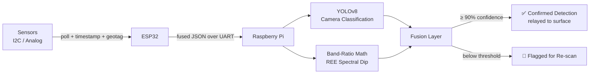
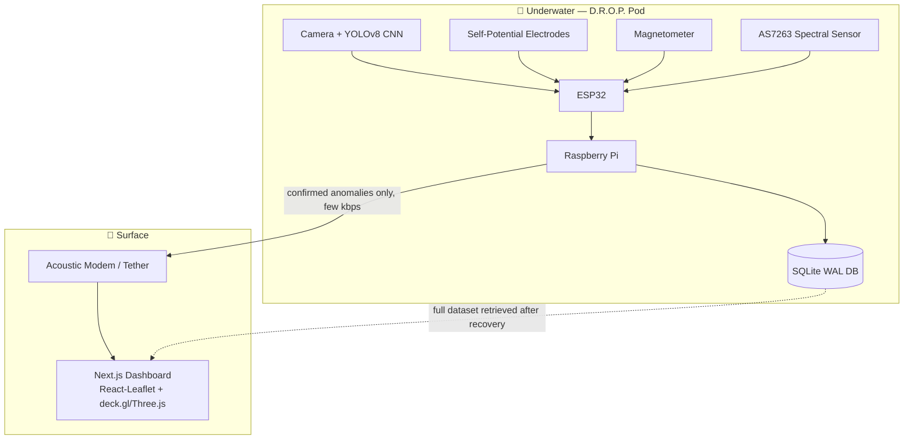

<div align="center">

# 🌊 D.R.O.P.
### Deep Ocean Research Observation Probe

**A detachable, low-cost sensor pod that turns any existing AUV/submarine into a real-time seafloor mineral-mapping platform.**

[](#-where-it-stands-right-now)
[](#-the-brain--the-ai)
[](#-where-it-stands-right-now)
[](#-license)

</div>

---

## 🎯 The Problem

Deep-sea mineral exploration today is **slow, blind, and expensive**.

| Reality | Impact |
|---|---|
| 🔍 Less than **0.001%** of the deep ocean has ever been surveyed | We know almost nothing about where deposits actually are |
| 🧪 Confirming a deposit means dredging a physical sample and lab-testing it | **Days to weeks** of turnaround per data point |
| 💰 Marine magnetometers & hyperspectral imagers cost **tens of thousands of dollars** each | Continuous, fine-grained scouting is out of reach for most programs |
| 🗺️ India's own Central Indian Ocean Basin zone — **75,000 km²**, ~366 million metric tons of nodules — is sampled at a coarse **12.5 km interval** | Massive blind spots between data points |
| ⚠️ A 1989 seafloor-disturbance test still showed untouched damage tracks **26 years later** | Imprecise exploration → far more seafloor disturbed during extraction than necessary, and it doesn't heal |

> **The core issue:** we can't extract responsibly what we haven't precisely mapped.

---

## 💡 The Core Idea

D.R.O.P. is **not** a new vehicle — it's a **detachable sensor pod** that mounts onto a submarine or AUV you already have.

As the host vehicle flies a standard **lawnmower survey pattern** over the seafloor, D.R.O.P. continuously **senses, classifies, and geotags** four target deposit types **in real time** — building a live, confidence-scored map instead of waiting weeks for lab results.

```
🎯 Target Deposits
├── 🪨 Polymetallic Nodules
├── 🧱 Cobalt-Rich Crusts
├── 🌋 Hydrothermal Sulphides
└── ✨ REE-Bearing Sediments
```

---

## 🔬 How It Senses Each Minerals

Instead of one instrument stretched thin across four problems, **each deposit type is sensed by the one physical signature that actually distinguishes it.**

<table>
<tr>
<td width="25%" align="center"><b>🪨 Nodules & Crusts</b></td>
<td>Camera + edge-AI CNN (<b>YOLOv8</b>) reads shape and surface texture. Crust frames get an extra <b>polarization + homomorphic-filtering</b> pass to cut through turbidity before classification.</td>
</tr>
<tr>
<td align="center"><b>🌋 Hydrothermal Sulphides</b></td>
<td>A pair of <b>Ag/AgCl self-potential electrodes</b> picks up the natural voltage anomaly buried sulphide ore produces, backed by a <b>magnetometer</b> for conductivity/ferrous anomalies. This is the <i>only</i> method here that can catch deposits with zero visual signature.</td>
</tr>
<tr>
<td align="center"><b>✨ REE-Bearing Sediment</b></td>
<td>A narrowband spectral sensor (<b>AS7263</b>) shines light on sediment and checks for the specific neodymium absorption dip at <b>~740 / 800 / 865 nm</b> — using cheap fixed-wavelength photodiodes instead of a full hyperspectral camera.</td>
</tr>
</table>

---

## 🧠 The Brain & The AI



**Pipeline breakdown:**
1. An **ESP32** continuously polls every I²C/analog sensor, timestamps and geotags each reading, and streams a fused JSON packet over UART.
2. A **Raspberry Pi** runs **YOLOv8** (backbone → neck → anchor-free head → NMS) on the camera feed for nodule/crust classification, while separately running band-ratio math on the spectral channel to catch REE dips.
3. A **fusion layer** combines every signal into one confidence score per reading:
   - **≥ 90%** → logged as a confirmed detection, relayed to the surface
   - **< 90%** → flagged for a re-scan pass instead of being reported as fact

---

## 💾 Storage & Communication

Bandwidth underwater is precious — D.R.O.P. is built around that constraint from the ground up.

- Every fused reading is written to an onboard **SQLite database (WAL mode)**, with camera frames saved separately and cross-referenced.
- **Only small, confirmed anomaly packets** — never raw video or the full sensor stream — go out over the acoustic modem/tether link *during* the mission, keeping bandwidth needs to **a few kbps**.
- The **complete dataset is retrieved physically after recovery.**

---

## 🗺️ The Mapping Output

Each sensor layer — optical, magnetic, electrochemical, spectral — is **independently interpolated using Kriging** to fill gaps between survey tracks, then normalized and fused into one composite score.

The result: a **live, confidence-scored 3D heatmap** — showing not just *where* the minerals are, but *how sure* the system is at every point.

**Rendered via:**
- ⚛️ Next.js / React-Leaflet — dashboard shell & 2D map layer
- 🌐 deck.gl + Three.js — 3D seafloor relief & heatmap visualization

---

## 🛠️ Hull & Build

A retrofit-friendly housing designed for real depth resistance without the cost of a fully rated pressure vessel:

| Component | Housing |
|---|---|
| Main electronics | Aluminum or titanium **pressure cylinder** |
| Camera pair | **Glass dome viewport** |
| Non-critical electronics (e.g. magnetometer) | **Oil-filled, pressure-compensated** housing |

---

## ⚡ What Makes It Different

> It isn't one instrument stretched across four problems.

- ✅ Each deposit type is sensed by its **one distinguishing physical signature**
- ✅ Fused and classified **on-device, in real time**
- ✅ Roughly **10–100× lower cost** than the commercial equivalent instruments
- ✅ **Confidence scoring** gives survey teams an honest sense of what's solid and what still needs a second look
- ✅ **Retrofits onto existing vehicles** — no new AUV required

---

## 📐 System Architecture Overview



---

## 🚧 Where It Stands Right Now

This is a **hackathon-stage concept**, built for Smart India Hackathon–style pitching.

| ✅ Done | ⏳ Not Yet Done |
|---|---|
| Architecture fully designed | Physical hardware build |
| Sensor selection finalized | Field testing |
| Wiring planned | Real-world validated accuracy figures |
| Onboard software written | — |

> ⚠️ **Note:** Figures like detection accuracy or confidence percentages used in pitch materials are **illustrative targets**, not measured results — yet.

---

## 📂 Suggested Repository Structure

```
DROP/
├── firmware/           # ESP32 sensor polling + UART fusion packet code
├── edge-ai/            # Raspberry Pi: YOLOv8 inference, band-ratio REE logic, fusion layer
├── dashboard/          # Next.js / React-Leaflet / deck.gl / Three.js frontend
├── docs/               # Architecture diagrams, sensor datasheets, pitch deck
├── hardware/           # Housing CAD, wiring diagrams, BOM
└── README.md
```

---

## 🤝 Contributing

This project is currently in active hackathon development. Issues, ideas, and pull requests are welcome — especially around sensor fusion logic, Kriging interpolation tuning, and the 3D dashboard.

## 📜 License

This project is released under the **MIT License** — see `LICENSE` for details.

---

<div align="center">

**Built with ⚙️ curiosity and 🌊 a lot of respect for the ocean floor.**

</div>
